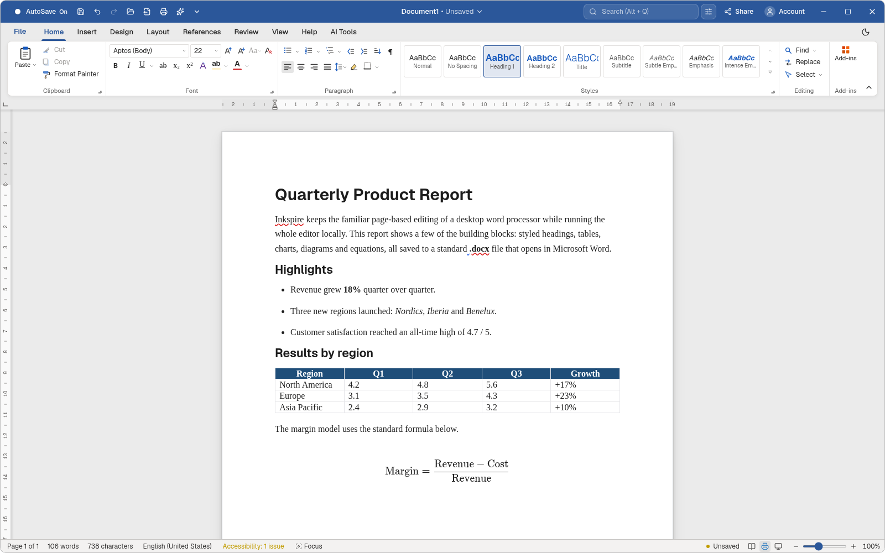
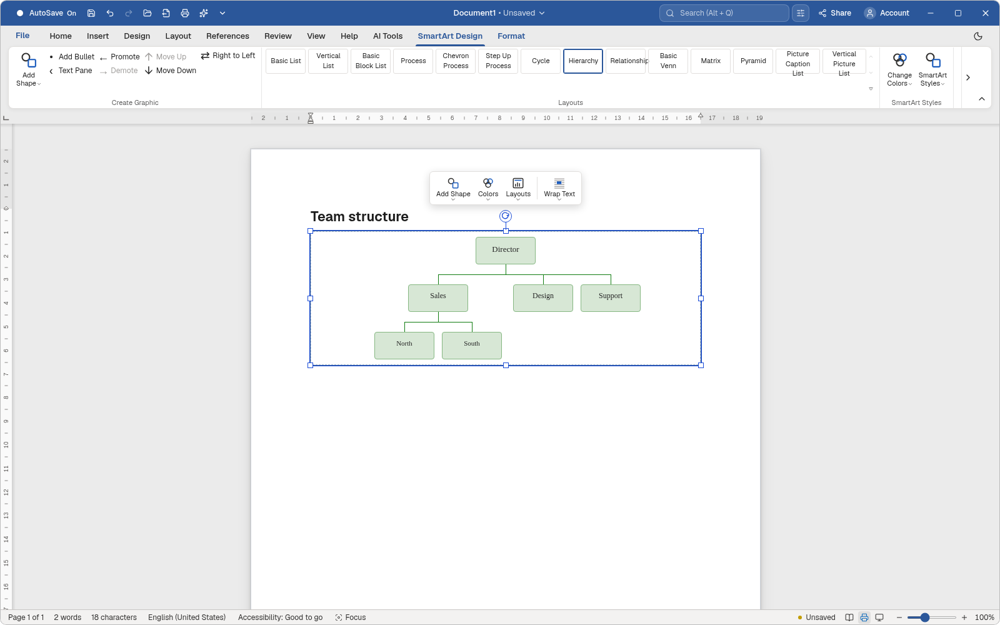
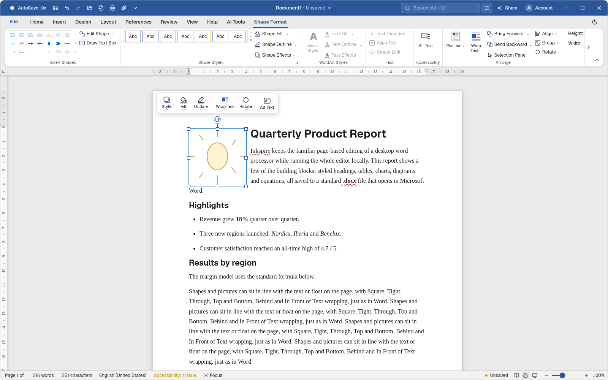
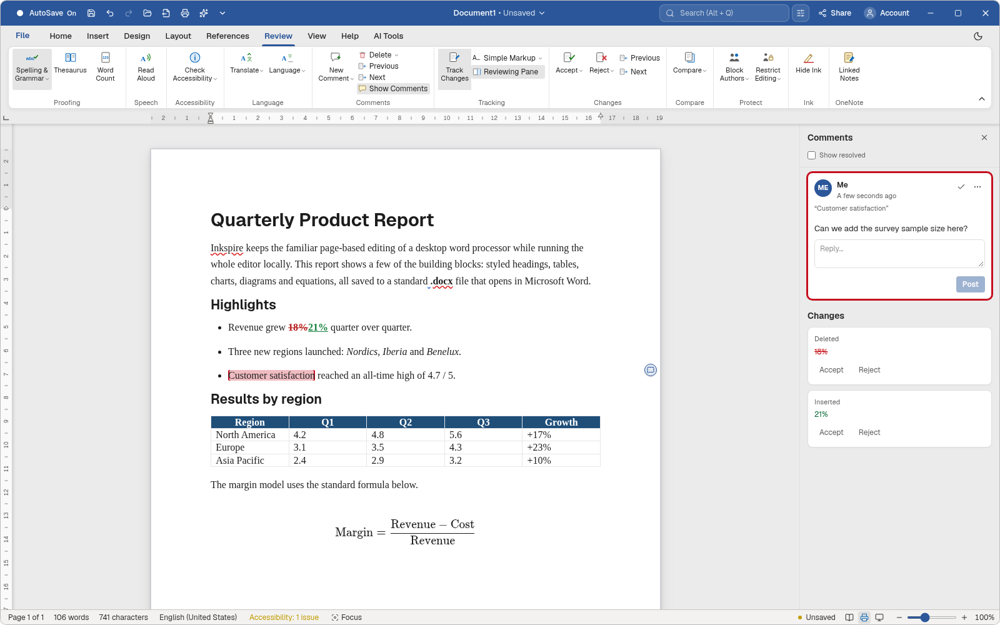
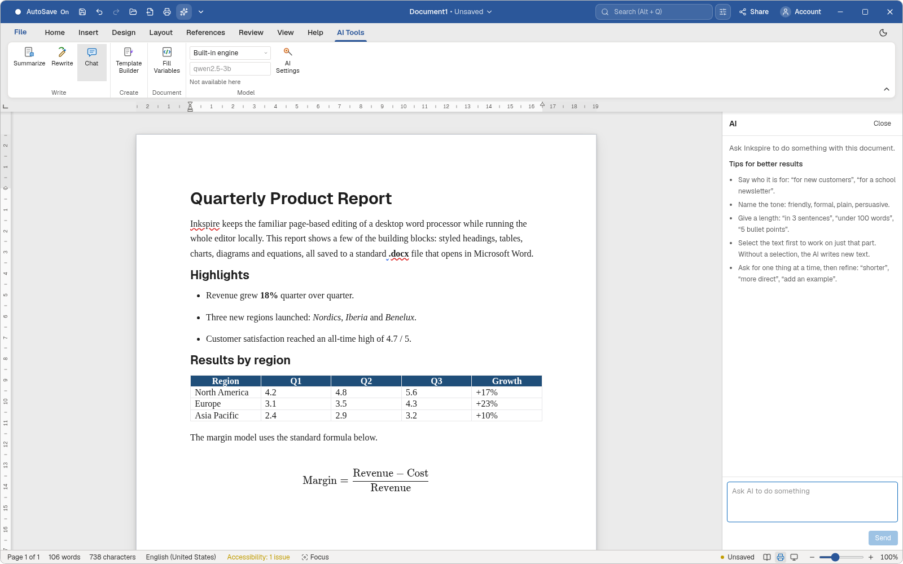
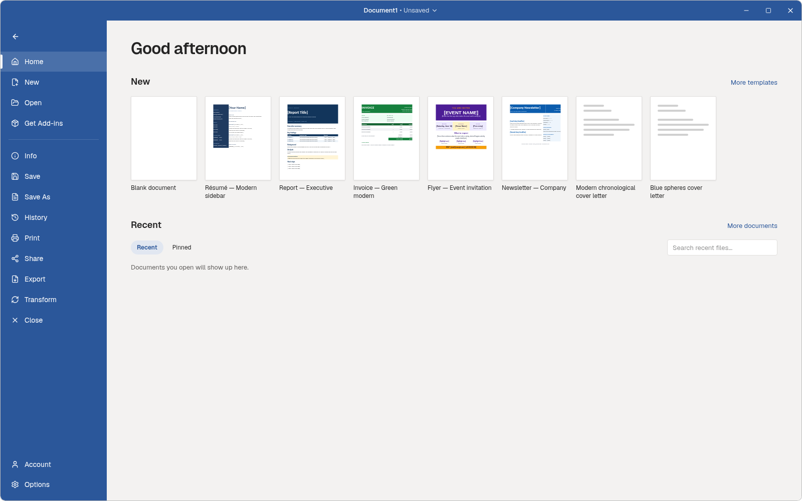
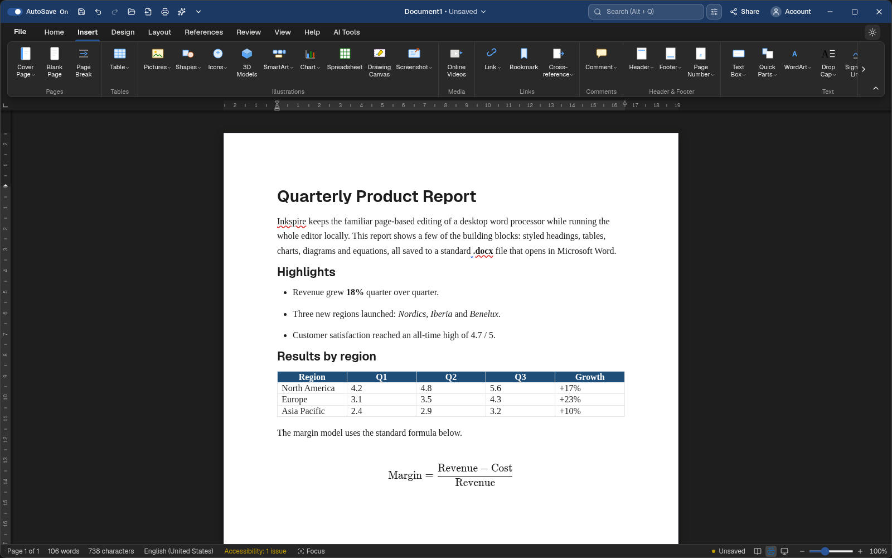

# Inkspire

Inkspire is a local, AI-first desktop word processor. It looks and behaves like a familiar ribbon editor (pages, headers, track changes, Office import/export) while keeping your documents and API keys on your machine. The UI is React + TipTap; the shell is [Tauri 2](https://tauri.app/).



## Download and install

Get the latest installers from the [Releases page](https://github.com/Shani2480/Inkspire/releases/latest). The Windows and Linux builds are for x86_64 (64-bit Intel/AMD); the macOS build runs natively on Apple Silicon and Intel.

| System                               | File                                |                                            |
| ------------------------------------ | ----------------------------------- | ------------------------------------------ |
| Windows 10 / 11                      | `Inkspire_<version>_x64-setup.exe`  | [Windows](#windows)                        |
| macOS 11 or newer                    | `Inkspire_<version>_universal.dmg`  | [macOS](#macos)                            |
| Debian, Ubuntu, Linux Mint, Pop!\_OS | `Inkspire_<version>_amd64.deb`      | [.deb](#debian-ubuntu-and-derivatives-deb) |
| Any Linux with Flatpak               | `Inkspire_<version>_x86_64.flatpak` | [Flatpak](#flatpak)                        |
| Any Linux                            | `Inkspire_<version>_amd64.AppImage` | [AppImage](#appimage)                      |

### Windows

1. Download `Inkspire_<version>_x64-setup.exe` and run it.
2. The installer is not code-signed yet, so Windows SmartScreen shows "Windows protected your PC". Click **More info**, then **Run anyway**.
3. Inkspire installs for your user (no administrator rights needed) and adds a Start menu entry. Uninstall it from **Settings → Apps**.

Inkspire uses the WebView2 runtime, which Windows 10 and 11 already have; the installer fetches it if it is missing.

### macOS

1. Open `Inkspire_<version>_universal.dmg` and drag **Inkspire** into **Applications**.
2. The app is not notarized by Apple yet, so the first start is blocked ("Inkspire can't be opened"). In **Applications**, right-click (or Control-click) Inkspire, choose **Open**, then **Open** again. On macOS 15 and later, if there is no Open button, go to **System Settings → Privacy & Security**, scroll to Security and click **Open Anyway**.
3. After that it starts normally. API keys are kept in your Keychain. Remove it by dragging it from Applications to the Bin.

The built-in AI engine is Linux-only for now; on a Mac use Ollama, OpenAI or Anthropic.

### Debian, Ubuntu and derivatives (.deb)

```bash
sudo apt install ./Inkspire_<version>_amd64.deb
```

`apt` pulls in the libraries it needs (WebKitGTK 4.1, GTK 3). Start Inkspire from the applications menu or run `inkspire`. Remove it with `sudo apt remove inkspire`. Ubuntu 22.04 or newer (or Debian 12 or newer) is needed.

### Flatpak

The Flatpak runs on the GNOME 50 runtime from Flathub. Add Flathub once if you have not:

```bash
flatpak remote-add --user --if-not-exists flathub https://dl.flathub.org/repo/flathub.flatpakrepo
flatpak install --user ./Inkspire_<version>_x86_64.flatpak
flatpak run com.aiword.app
```

The app can open and save documents anywhere in your home folder, reach the network for AI providers, and keep API keys in your desktop keyring. Remove it with `flatpak uninstall com.aiword.app`.

### AppImage

```bash
chmod +x Inkspire_<version>_amd64.AppImage
./Inkspire_<version>_amd64.AppImage
```

Nothing is installed; delete the file to remove it. If it does not start, install FUSE 2 (`sudo apt install libfuse2` on Ubuntu, `fuse2` on Arch).

### After installing

On first start Inkspire asks for your name and regional formats, and offers optional downloads: Pandoc (ODT and RTF), Typst (PDF) and the built-in AI engine. Each is unticked; you can add them later. To use OpenAI or Anthropic, open **AI Tools → AI Settings** and paste a key; for Ollama, point it at your local server.

## Features

- Page-oriented editing with rulers, zoom, headers/footers, and custom pagination (keep with next, page break before, table rows that split across pages under a repeated header row)
- Home / Insert / Design / Layout / References / Review / View / AI Tools ribbon, with contextual tabs for tables, pictures, shapes, charts, SmartArt and equations
- Charts (column, line, pie, treemap, filled maps and more) with an embedded data sheet, chart elements, styles and filters
- SmartArt diagrams, shapes, WordArt, text boxes and pictures, with Square, Tight, Through, Top and Bottom, Behind and In Front of Text wrapping and editable wrap points
- Equations, tables with table styles, footnotes, tables of contents, citations and cross-references
- Comments and tracked changes with a reviewing pane
- AI rewrite, summarize, templates, themes, proofing, and a side chat panel (OpenAI, Anthropic, or local Ollama)
- Open and save HTML; open and save DOCX natively; ODT, RTF and PDF through Pandoc and Typst, which you choose to download (see below)
- Light and dark themes
- Crash recovery drafts and a recent-files list in app data
- Keys and credentials stay in the desktop app (`$APPCONFIG`), not in the web view

## Tour

### Charts

Insert a chart from the ribbon, edit its numbers in the docked data sheet, and turn chart elements on and off from the buttons beside it.


### SmartArt

Hierarchy, process, cycle, list, matrix and pyramid layouts. Diagrams are saved as Word's own SmartArt, so they stay editable in Microsoft Word.



### Shapes and text wrapping

Shapes, pictures and text boxes float on the page with Word's wrapping options, and the Shape Format tab offers fills, outlines, effects and arrangement.



### Review

Comments, tracked insertions and deletions, and accept or reject from the Reviewing Pane.



### AI tools

Summarize, rewrite, build templates and chat about the document with a built-in engine, a local Ollama model, OpenAI or Anthropic.



### File and templates

The File view opens recent documents and starts new ones from templates.



### Dark mode



## Requirements

- Node.js 22+ (npm)
- [Rust](https://rustup.rs/) stable (edition 2024; recent rustc)
- Platform webview: WebKitGTK (Linux), WebView2 (Windows), or system WebView (macOS)
- Optional, downloaded by the app when you choose: Pandoc (ODT/RTF, PDF) and Typst (PDF), plus the built-in AI engine

## Build from source

On Windows, follow [WINDOWS.md](WINDOWS.md) (tools to install, cloning with LF line endings, the desktop build and installers, and what does not travel with the repository).

```bash
npm install
```

### Pandoc and Typst (optional downloads)

Nothing is bundled. The first-run setup offers Pandoc 3.12.1 (~35 MB) and Typst 0.15.1 (~17 MB) as unticked choices, and the app asks again when ODT, RTF or PDF is used and a tool is missing. Downloads come from the projects' GitHub releases, are checked against a pinned SHA-256, and live in the app's data folder. A copy already on your `PATH` is used instead. The pinned list is in `src-tauri/src/tools.rs`.

### AI keys

1. Run the desktop app (`npm run tauri dev`).
2. Open **AI Tools → AI keys** (or the keys dialog from the AI UI).
3. Choose a provider: **Local Ollama**, **OpenAI**, or **Anthropic**.
4. Paste keys for OpenAI/Anthropic and use **Test connection**. Ollama needs a local server (default `http://127.0.0.1:11434`); no cloud key.
5. Pick a model per provider if you want something other than the defaults.

Keys are stored by the Rust side under the app config directory with owner-only permissions. They are never written into document HTML.

## Android tablet (preview)

The same app builds for Android tablets with Tauri's Android target (the `android` branch). It opens on the single-line ribbon with finger-sized targets, keeps the document above the on-screen keyboard, and opens and saves documents through Android's file picker, saving back to the same file and reopening from Recent after a restart. AI works with OpenAI, Anthropic, or an Ollama server on your network; keys are kept in the app's private storage.

Not on Android: Pandoc and Typst (ODT, RTF and PDF), the built-in AI engine, separate windows and Open Containing Folder.

Build a debug APK for the emulator or a device (Android SDK, NDK 30 and the Rust Android targets installed):

```bash
export ANDROID_HOME=~/Android/Sdk NDK_HOME=~/Android/Sdk/ndk/30.0.16248370
npm run tauri android build -- --debug --apk                   # every ABI
npm run tauri android build -- --debug --target x86_64 --apk   # emulator only, faster
adb install -r src-tauri/gen/android/app/build/outputs/apk/universal/debug/app-universal-debug.apk
```

`src-tauri/gen/android/` is the generated Android Studio project; `MainActivity.kt` there holds the Android-only parts (system-bar and keyboard insets, the read/write document picker, file names for content links).

## Develop

Web UI only (no native shell / no AI key IPC):

```bash
npm run dev
```

Full desktop app:

```bash
npm run tauri dev
```

Useful scripts:

| Command                            | What it does                                                            |
| ---------------------------------- | ----------------------------------------------------------------------- |
| `npm run build`                    | Typecheck + Vite production build                                       |
| `npm test`                         | Vitest                                                                  |
| `npm run lint`                     | ESLint + Prettier check                                                 |
| `cd src-tauri && cargo test --lib` | Rust unit tests (the Pandoc round-trip runs when Pandoc is on the PATH) |

## CI

GitHub Actions (`.github/workflows/ci.yml`) runs lint, Vitest, `npm run build`, and `cargo test --lib` on push/PR.

Pushing a `v*` tag runs `.github/workflows/release.yml`, which builds the `.deb` and AppImage on Ubuntu 22.04, a Flatpak from that `.deb` (`packaging/flatpak/`), and the Windows setup `.exe`, and publishes them as a GitHub release.
